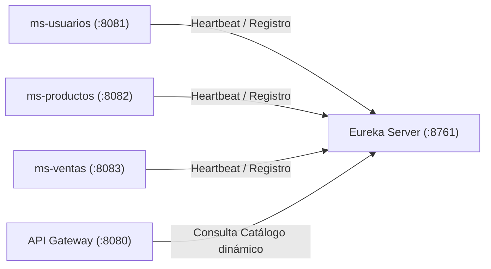

# Implementación Detallada de Requisitos - OYL Frutos Secos

Este documento técnico explica en detalle cómo se implementó cada uno de los 7 requisitos arquitectónicos del proyecto **OYL Frutos Secos**, qué elementos clave se agregaron a nivel de diseño y cómo se reflejan tanto en la aplicación móvil como en el comportamiento interno del sistema.

---

## Índice de Requisitos
1. [Eureka: Registro y Descubrimiento Dinámico](#1-eureka-registro-y-descubrimiento-dinámico)
2. [Retrofit: Cliente de Red en Android](#2-retrofit-cliente-de-red-en-android)
3. [Al menos 3 Microservicios Mínimos Independientes](#3-al-menos-3-microservicios-mínimos-independientes)
4. [API Gateway: Punto Central de Entrada](#4-api-gateway-punto-central-de-entrada)
5. [Pruebas Unitarias Independientes](#5-pruebas-unitarias-independientes)
6. [Firma de APK: Compilación Release en Gradle](#6-firma-de-apk-compilación-release-en-gradle)
7. [Base de Datos Centralizada en PostgreSQL y Flyway](#7-base-de-datos-centralizada-en-postgresql-y-flyway)

---

## 1. Eureka: Registro y Descubrimiento Dinámico



### ¿Cómo se implementó?
* **Módulo servidor**: Se creó el proyecto independiente `backend/eureka-server` configurado en el puerto **8761**, anotado con `@EnableEurekaServer` en su clase principal `EurekaServerApplication.java`.
* **Configuración del servidor (`application.yml`)**:
  ```yaml
  server:
    port: 8761
  eureka:
    client:
      register-with-eureka: false # No se registra a sí mismo
      fetch-registry: false
  ```
* **Clientes Eureka**: En los microservicios (`ms-usuarios`, `ms-productos`, `ms-ventas`) y en el `api-gateway`, se incorporó `spring-cloud-starter-netflix-eureka-client` y la anotación `@EnableDiscoveryClient`.

### Cosas importantes que se agregaron
* **Auto-registro y Heartbeats periódicos**: Cada microservicio emite un latido cada 30 segundos. Si un servicio se cae o cambia de dirección IP, Eureka lo retira de la lista de servicios activos para que el Gateway no le envíe tráfico.
* **Dashboard visual de monitoreo**: Al acceder a [http://localhost:8761](http://localhost:8761) en el navegador, se visualiza en tiempo real el estado (`UP`), tiempo de actividad, IP y puerto de cada componente registrado.

### ¿Cómo se ve reflejado en la App y comportamiento interno?
* **En el comportamiento interno**: El API Gateway **nunca tiene direcciones IP ni puertos fijos de los microservicios**. Solo utiliza nombres lógicos como `lb://MS-PRODUCTOS`. Eureka se encarga de resolver la dirección real en cada petición.
* **En la App móvil**: Si en el futuro se despliegan 3 copias de `ms-productos` para soportar una alta demanda en una campaña de ventas, la aplicación móvil Android no sufre ningún cambio; Eureka distribuye la carga de manera transparente.

---

## 2. Retrofit: Cliente de Red en Android

### ¿Cómo se implementó?
* **Ubicación exclusiva en Android**: Implementado dentro de `app/src/main/java/com/OYL/frutossecos/data/remote/`.
* **Cliente centralizado (`ApiClient.kt`)**: Implementa el patrón Singleton sobre `Retrofit.Builder()`, configurando:
  * URL base única hacia el API Gateway: `http://10.0.2.2:8080/`.
  * Conversor JSON automático: `GsonConverterFactory.create()`.
  * Interceptor de depuración: `HttpLoggingInterceptor` para auditar peticiones y respuestas en el Logcat.
  * Tiempos de espera (*timeouts*): 15 segundos para conexión, lectura y escritura.
* **Interfaces Retrofit y DTOs tipados**:
  * `AuthApiService.kt`: Rutas suspendidas de autenticación (`api/usuarios/login`, `api/usuarios/register`).
  * `ProductApiService.kt`: Rutas de catálogo (`api/productos`, `api/categorias`, `api/productos/buscar`).
  * `OrderApiService.kt`: Rutas de compra (`api/ventas`, `api/ventas/usuario/{id}`).
  * `RemoteDtos.kt`: Clases de datos Kotlin con anotaciones `@SerializedName` para deserializar las respuestas JSON del backend.

### Cosas importantes que se agregaron
* **Soporte de tráfico local sin restricciones**: Se agregó `android:usesCleartextTraffic="true"` en `AndroidManifest.xml`, lo que permite que Android 9+ realice peticiones HTTP al entorno de desarrollo local sin ser bloqueado por las políticas de seguridad de red por defecto.
* **Resolución de IP para emuladores**: El emulador de Android Studio no puede usar `localhost` para comunicarse con la máquina anfitriona; se configuró la IP virtual estándar de Android: `10.0.2.2:8080`.

### ¿Cómo se ve reflejado en la App móvil?
* La aplicación consume el backend dentro de corrutinas (`viewModelScope.launch`) de forma asíncrona, evitando que la interfaz de usuario se congele durante las llamadas de red.
* Permite migrar gradualmente la lógica de los ViewModels desde la base de datos local SQLite (Room) hacia las APIs remotas simplemente invocando `ApiClient.productService.listarProductos()`.

---

## 3. Al menos 3 Microservicios Mínimos Independientes

### ¿Cómo se implementó?
Se implementaron 3 servicios de dominio desacoplados, cada uno con su propio `pom.xml`, base de datos y ciclo de vida:

1. **`ms-usuarios` (Puerto 8081)**:
   * **Responsabilidad**: Registro de clientes, inicio de sesión, roles y seguridad.
   * **Capas**: `UsuarioController`, `UsuarioService`, `UsuarioRepository`, `Usuario` (Entity), DTOs de registro y login.
2. **`ms-productos` (Puerto 8082)**:
   * **Responsabilidad**: Catálogo de productos, categorías y stock.
   * **Capas**: `ProductoController`, `CategoriaController`, `ProductoService`, `CategoriaService`, `ProductoRepository`, `CategoriaRepository`.
3. **`ms-ventas` (Puerto 8083)**:
   * **Responsabilidad**: Carrito final, confirmación de compras, líneas de detalle de pedido y estados.
   * **Capas**: `VentaController`, `VentaService`, `VentaRepository`, `DetalleVentaRepository`, entidades `Venta` y `DetalleVenta`.

### Cosas importantes que se agregaron
* **Límites de Contexto (*Bounded Contexts*)**: No existen claves foráneas de base de datos directas entre microservicios. `ms-ventas` no apunta por clave foránea SQL a la tabla de usuarios de `ms-usuarios`; almacena un campo `usuario_id BIGINT` y consume la información mediante DTOs.
* **Seguridad y Criptografía con BCrypt**: Las contraseñas de los usuarios no se guardan en texto plano; se utiliza `BCryptPasswordEncoder` con salt automático en `ms-usuarios`.
* **Manejo Centralizado de Excepciones**: Cada microservicio cuenta con un `GlobalExceptionHandler` anotado con `@RestControllerAdvice` que captura errores como `ResourceNotFoundException`, `InsufficientStockException` o validaciones `@Valid`, retornando un objeto JSON uniforme (`ErrorResponse`) con códigos HTTP estándar (400, 404, 409, 500).

### ¿Cómo se ve reflejado en la App y comportamiento interno?
* **Aislamiento de fallas**: Si por alguna razón `ms-ventas` entra en mantenimiento o experimenta problemas, la app móvil aún permite que los usuarios inicien sesión (`ms-usuarios`) y consulten el catálogo (`ms-productos`). El fallo de un dominio no tumba la aplicación completa.

---

## 4. API Gateway: Punto Central de Entrada

### ¿Cómo se implementó?
* **Tecnología**: Se implementó `backend/api-gateway` en el puerto **8080**, utilizando **Spring Cloud Gateway reactivo basado en WebFlux** y el motor de red no bloqueante **Netty**.
* **Ruteo dinámico con descubrimiento en `application.yml`**:
  ```yaml
  spring:
    cloud:
      gateway:
        routes:
          - id: ms-usuarios
            uri: lb://MS-USUARIOS
            predicates:
              - Path=/api/usuarios/**, /api/auth/**
          - id: ms-productos
            uri: lb://MS-PRODUCTOS
            predicates:
              - Path=/api/productos/**, /api/categorias/**
          - id: ms-ventas
            uri: lb://MS-VENTAS
            predicates:
              - Path=/api/ventas/**, /api/pedidos/**
  ```

### Cosas importantes que se agregaron
* **Balanceo con `lb://`**: Las solicitudes son balanceadas dinámicamente mediante Spring Cloud LoadBalancer hacia las instancias reportadas por Eureka.
* **CORS Global**: Se configuró la política de intercambio de recursos de origen cruzado (`globalcors`) para autorizar encabezados, métodos (`GET`, `POST`, `PUT`, `DELETE`, `PATCH`, `OPTIONS`) y orígenes (`*`).

### ¿Cómo se ve reflejado en la App?
* **Simplicidad para el desarrollador móvil**: La app Android no tiene que saber en qué puerto o servidor está cada microservicio. Solo realiza peticiones al puerto 8080:
  * Petición a `/api/productos` $\rightarrow$ El Gateway la intercepta y la reenvía a `ms-productos` (:8082).
  * Petición a `/api/usuarios/login` $\rightarrow$ El Gateway la reenvía a `ms-usuarios` (:8081).
  * Petición a `/api/ventas` $\rightarrow$ El Gateway la reenvía a `ms-ventas` (:8083).

---

## 5. Pruebas Unitarias Independientes

### ¿Cómo se implementó?
* Cada microservicio cuenta con su propia carpeta `src/test/java/` y `src/test/resources/`.
* Se implementaron pruebas funcionales y de lógica de negocio usando **JUnit 5 (Jupiter)** y **Mockito**:
  * `UsuarioServiceTest`: Verifica el registro correcto, el control de emails duplicados, el inicio de sesión exitoso y el rechazo por contraseña inválida.
  * `ProductoServiceTest`: Valida la creación de productos, el descuento de stock exitoso y el lanzamiento de excepción cuando el stock solicitado supera al disponible.
  * `VentaServiceTest`: Valida el cálculo automático y matemático de subtotales y total general de la venta y la consulta de órdenes.
  * Pruebas de contexto de inicio en `eureka-server` y `api-gateway`.

### Cosas importantes que se agregaron
* **Bases de datos en memoria para pruebas (H2)**: Cada microservicio tiene un perfil de test (`src/test/resources/application.yml`) que utiliza una base de datos **H2 en memoria** simulando la sintaxis de PostgreSQL y desactivando Flyway para las pruebas.
* **Cero dependencias externas al compilar**: El comando `mvn -f backend/pom.xml test` se puede ejecutar en cualquier computadora o pipeline de CI/CD sin necesidad de tener un servidor PostgreSQL instalado o encendido; todas las pruebas compilan y pasan en verde (`BUILD SUCCESS`).

### ¿Cómo se ve reflejado en el comportamiento interno?
* Brinda certeza de que las reglas de negocio críticas (descuento de inventario, cálculo de totales de dinero y validación de contraseñas) no tienen errores lógicos antes de desplegar.

---

## 6. Firma de APK: Compilación Release en Gradle

### ¿Cómo se implementó?
* En `app/build.gradle.kts`, se configuró el bloque `signingConfigs`:
  ```kotlin
  val keystorePropertiesFile = rootProject.file("keystore.properties")
  val keystoreProperties = Properties()
  val hasKeystore = keystorePropertiesFile.exists()
  if (hasKeystore) {
      keystoreProperties.load(FileInputStream(keystorePropertiesFile))
  }

  signingConfigs {
      create("release") {
          if (hasKeystore) {
              storeFile = rootProject.file(keystoreProperties.getProperty("storeFile") ?: "oyl-release-key.jks")
              storePassword = keystoreProperties.getProperty("storePassword") ?: ""
              keyAlias = keystoreProperties.getProperty("keyAlias") ?: ""
              keyPassword = keystoreProperties.getProperty("keyPassword") ?: ""
          }
      }
  }

  buildTypes {
      release {
          if (hasKeystore) {
              signingConfig = signingConfigs.getByName("release")
          }
      }
  }
  ```

### Cosas importantes que se agregaron
* **Seguridad Estricta en Git**: Se agregó al archivo `.gitignore` la exclusión obligatoria de `*.jks`, `*.keystore` y `keystore.properties`. De esta forma, las llaves privadas y las contraseñas **jamás se suben a GitHub**.
* **Plantilla de referencia**: Se creó `keystore.properties.example` con la guía de campos requeridos.
* **Compilación condicional**: Si el archivo `keystore.properties` no existe (por ejemplo, en las máquinas de compañeros de equipo que solo prueban en Debug), el proyecto compila normalmente sin romper la compilación de Android Studio.

### ¿Cómo se ve reflejado en la App?
* Al ejecutar `./gradlew assembleRelease`, se genera el paquete binario oficial `app/build/outputs/apk/release/app-release.apk` firmado digitalmente con un certificado RSA de 2048 bits, listo para ser instalado en cualquier teléfono o distribuido.

---

## 7. Base de Datos Centralizada en PostgreSQL y Flyway

### ¿Cómo se implementó?
* Se implementó una **instancia centralizada de PostgreSQL** en el puerto 5432, dividida lógicamente en tres bases de datos:
  * `oyl_usuarios`
  * `oyl_productos`
  * `oyl_ventas`
* Se creó el script SQL maestro `backend/init-databases.sql` que crea las 3 bases de datos con codificación UTF-8.
* Cada microservicio incluye las dependencias:
  * `org.postgresql:postgresql`
  * `org.flywaydb:flyway-core`
  * `org.flywaydb:flyway-database-postgresql`

### Cosas importantes que se agregaron
* **Migraciones controladas por código con Flyway**: En lugar de confiar en la generación automática de Hibernate (`ddl-auto: update`), cada microservicio tiene sus scripts de migración versionados:
  * `ms-usuarios/src/main/resources/db/migration/V1__init_usuarios.sql`
  * `ms-productos/src/main/resources/db/migration/V1__init_productos.sql`
  * `ms-ventas/src/main/resources/db/migration/V1__init_ventas.sql`
  Al arrancar el servicio por primera vez, Flyway detecta las tablas faltantes y ejecuta el script automáticamente.
* **Soporte para variables de entorno**: Las URLs y credenciales admiten variables de entorno (`DB_URL`, `DB_USERNAME`, `DB_PASSWORD`), documentadas en `backend/.env.example`.

### ¿Cómo se ve reflejado en la App y comportamiento interno?
* **Persistencia permanente de datos**: Todo lo que ocurra en la aplicación (usuarios creados, compras confirmadas, variaciones de stock) se almacena de forma definitiva en PostgreSQL. Reiniciar el backend o la aplicación móvil no borra los datos.
* **Precisión en transacciones financieras**: En `ms-productos` y `ms-ventas`, los precios y subtotales se modelan con `NUMERIC(12,2)` a nivel de base de datos y `BigDecimal` a nivel de Java, evitando problemas de redondeo en monedas.
