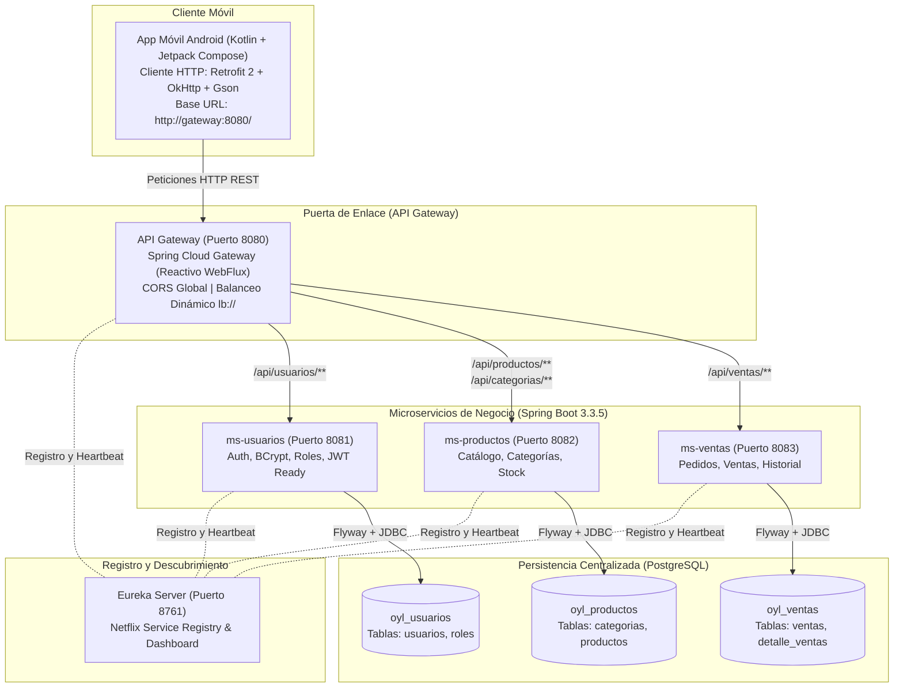

# OYL Frutos Secos - Sistema Integral Móvil y Microservicios

Bienvenido al repositorio oficial del proyecto **OYL Frutos Secos**, una solución de software completa desarrollada para la asignatura **Desarrollo de Aplicaciones Móviles (DSY1105)** en **Duoc UC**.

El proyecto integra una **aplicación móvil Android** de última generación desarrollada en Kotlin con Jetpack Compose y una **arquitectura backend empresarial basada en microservicios** con Java 21, Spring Boot 3.3.5, Spring Cloud (Netflix Eureka y API Gateway reactivo), PostgreSQL y migraciones automatizadas con Flyway.

---

## Integrantes
* **Piero Galiffa**
* **Juan Vargas**
* **Nicolas Rovegno**

---

## 1. Arquitectura General del Sistema

El ecosistema está diseñado bajo el patrón de **Microservicios con API Gateway Centralizado**, permitiendo que la aplicación móvil se comunique a través de un único punto de entrada (`http://10.0.2.2:8080/`), abstrayendo por completo los puertos internos y la topología de la red.



---

## 2. Componentes de la Solución

### A. Aplicación Móvil Android (`app/`)
* **Lenguaje y UI**: Kotlin 2.2 + Jetpack Compose + Material 3.
* **Arquitectura**: MVVM (Model-View-ViewModel) con StateFlow y Unidirectional Data Flow.
* **Cliente de Red**: **Retrofit 2.11 + OkHttp 4.12** configurado en `com.OYL.frutossecos.data.remote`.
* **Persistencia Local**: Room Database / SQLite para funcionamiento offline y caché.
* **Hardware y Sensores**:
  * **Cámara & Escáner QR**: CameraX + ZXing (soporta `OYL-PROD-<id>`, ID numérico y JSON).
  * **Geolocalización**: Google Maps Compose para tiendas y puntos de retiro.
* **Firma de APK**: Configuración segura de compilación Release mediante Gradle sin versionar credenciales ni llaves `.jks`.

### B. Arquitectura Backend de Microservicios (`backend/`)
* **Versiones Homologadas**: Java 21 LTS, Spring Boot 3.3.5, Spring Cloud 2023.0.4 (*Leyton Release Train*).
* **Módulos Independientes**:
  1. **`eureka-server` (Puerto 8761)**: Servidor Netflix Eureka para registro y monitoreo dinámico.
  2. **`api-gateway` (Puerto 8080)**: Gateway no bloqueante con Spring Cloud Gateway reactivo basado en WebFlux. Enruta dinámicamente (`lb://`) hacia los microservicios activos y resuelve políticas CORS.
  3. **`ms-usuarios` (Puerto 8081)**: Control de accesos, encriptación con `BCryptPasswordEncoder`, roles (`ROLE_CLIENTE`, `ROLE_ADMIN`, `ROLE_TRABAJADOR`) y DTOs listos para JWT.
  4. **`ms-productos` (Puerto 8082)**: Catálogo de productos, categorías, imágenes, precios y operaciones transaccionales de inventario (`DESCONTAR`/`REPONER`).
  5. **`ms-ventas` (Puerto 8083)**: Procesamiento de compras, líneas de detalle, cálculo seguro de subtotales y trazabilidad de estados (`PENDIENTE`, `PAGADO`, `ENTREGADO`, `CANCELADO`).
* **Bases de Datos**: PostgreSQL centralizado con bases lógicamente separadas (`oyl_usuarios`, `oyl_productos`, `oyl_ventas`) y migraciones Flyway automáticas.
* **Pruebas**: JUnit 5 + Mockito en cada microservicio con perfiles H2 de prueba independientes.

---

## 3. ¿Cómo Funciona la Comunicación con el API Gateway?

Gracias al API Gateway, el cliente Android **no necesita conocer los puertos internos** ni lidiar con múltiples URLs base:

1. En la app Android, `ApiClient.kt` define una única URL base:
   ```kotlin
   // 10.0.2.2 es la IP del Host en el emulador de Android Studio
   private const val BASE_URL = "http://10.0.2.2:8080/"
   ```
2. Las llamadas de Retrofit solo usan la ruta relativa:
   * `api/usuarios/login` $\rightarrow$ El Gateway la intercepta y la delega a `ms-usuarios` (:8081).
   * `api/productos` $\rightarrow$ El Gateway la delega a `ms-productos` (:8082).
   * `api/ventas` $\rightarrow$ El Gateway la delega a `ms-ventas` (:8083).

---

## 4. Guía de Ejecución Paso a Paso

### Opción A: Encendido Inmediato con Docker Compose (Recomendado) 🚀

Si tienes Docker instalado en tu equipo, puedes levantar toda la infraestructura del backend (PostgreSQL con sus 3 bases de datos inicializadas, Eureka Server, los 3 microservicios y el API Gateway) con **un solo comando** desde la raíz del proyecto:

```bash
docker-compose up --build -d
```

* **Ver el estado de los contenedores**:
  ```bash
  docker-compose ps
  ```
* **Ver los logs en tiempo real**:
  ```bash
  docker-compose logs -f
  ```
* **Detener todo**:
  ```bash
  docker-compose down
  ```

---

### Opción B: Ejecución Manual Nativa (Paso a Paso)
Abre tu consola o cliente SQL (psql / pgAdmin) y ejecuta el script de inicialización:
```bash
psql -U postgres -f backend/init-databases.sql
```
*Esto creará las 3 bases de datos: `oyl_usuarios`, `oyl_productos` y `oyl_ventas`.*

---

### Paso 2: Iniciar los Servicios del Backend (En este orden)

Abre terminales separadas para cada servicio:

1. **Terminal 1 - Eureka Server**:
   ```bash
   cd backend/eureka-server
   mvn spring-boot:run
   ```
   *Verificar en el navegador:* [http://localhost:8761](http://localhost:8761).

2. **Terminal 2 - Microservicio de Usuarios**:
   ```bash
   cd backend/ms-usuarios
   mvn spring-boot:run
   ```

3. **Terminal 3 - Microservicio de Productos**:
   ```bash
   cd backend/ms-productos
   mvn spring-boot:run
   ```

4. **Terminal 4 - Microservicio de Ventas**:
   ```bash
   cd backend/ms-ventas
   mvn spring-boot:run
   ```

5. **Terminal 5 - API Gateway**:
   ```bash
   cd backend/api-gateway
   mvn spring-boot:run
   ```
   *Al abrir [http://localhost:8761](http://localhost:8761) verás los 4 servicios registrados en Eureka.*

---

### Paso 3: Ejecutar Pruebas Unitarias del Backend
Para compilar todos los microservicios y validar la suite de pruebas unitarias:
```bash
mvn -f backend/pom.xml test
```
*Todas las pruebas se ejecutan con bases de datos en memoria H2 aisladas, arrojando `BUILD SUCCESS`.*

---

### Paso 4: Ejecutar la Aplicación Android

1. Abre la raíz del proyecto en **Android Studio**.
2. Espera a que finalice la sincronización de Gradle (`Sync Project with Gradle Files`).
3. Inicia un emulador Android (por ejemplo, Pixel 8 con API 34 o 35).
4. Presiona el botón **Run 'app'** ($\blacktriangleright$).
5. La app se conectará automáticamente al API Gateway a través de `http://10.0.2.2:8080/`.

> [!TIP]
> **¿Vas a probar en un teléfono físico con cable o WiFi?**
> Abre `app/src/main/java/com/OYL/frutossecos/data/remote/ApiClient.kt` y cambia `10.0.2.2` por la IP local de tu computador en la red WiFi (ejemplo: `http://192.168.1.15:8080/`).

---

## 5. Firma de APK para Producción (Release)

El proyecto incluye la configuración para generar el APK de lanzamiento firmado digitalmente sin exponer contraseñas en Git:

1. Generar tu clave privada con `keytool` (si aún no tienes una):
   ```bash
   keytool -genkey -v -keystore oyl-release-key.jks -alias oyl_key_alias -keyalg RSA -keysize 2048 -validity 10000
   ```
2. Crear un archivo llamado `keystore.properties` en la raíz del proyecto (basado en `keystore.properties.example`):
   ```properties
   storeFile=oyl-release-key.jks
   storePassword=tu_password_del_keystore
   keyAlias=oyl_key_alias
   keyPassword=tu_password_de_la_clave
   ```
3. Compilar el APK release firmado:
   ```bash
   ./gradlew assembleRelease
   ```
4. El APK resultante se encontrará listo en:
   `app/build/outputs/apk/release/app-release.apk`.

---

## 6. Estructura de Carpetas del Repositorio

```text
OYL-frutos-secos/
├── app/                        <-- Aplicación móvil Android (Jetpack Compose + Kotlin)
│   ├── build.gradle.kts        <-- Configuración Gradle, dependencias y firma APK
│   └── src/main/java/com/OYL/frutossecos/
│       ├── data/
│       │   ├── local/          <-- Room Database, DAOs, Entidades SQLite locales
│       │   ├── remote/         <-- Retrofit ApiClient, Servicios y DTOs para el Gateway
│       │   └── repository/     <-- Repositorios de datos
│       ├── ui/                 <-- Pantallas Compose, ViewModels, Navegación y Tema
│       └── MainActivity.kt
│
├── backend/                    <-- Arquitectura de microservicios Spring Boot
│   ├── pom.xml                 <-- Parent POM Maven multi-módulo (Spring Boot 3.3.5)
│   ├── .env.example            <-- Plantilla de variables de entorno
│   ├── init-databases.sql      <-- Script SQL de inicialización en PostgreSQL
│   ├── README.md               <-- Documentación técnica detallada del backend
│   ├── eureka-server/          <-- Registro y Descubrimiento (Puerto 8761)
│   ├── api-gateway/            <-- Gateway Reactivo WebFlux (Puerto 8080)
│   ├── ms-usuarios/            <-- Microservicio de Usuarios (Puerto 8081)
│   ├── ms-productos/           <-- Microservicio de Productos y Stock (Puerto 8082)
│   └── ms-ventas/              <-- Microservicio de Ventas y Pedidos (Puerto 8083)
│
├── keystore.properties.example <-- Plantilla para configuración de firma APK
├── .gitignore                  <-- Bloquea subida de .jks, .env y keystore.properties
└── README.md                   <-- Documentación principal del proyecto
```

---

## 7. Catálogo de Endpoints Expuestos (API Gateway :8080)

| Módulo | Método | Endpoint | Descripción |
| :--- | :---: | :--- | :--- |
| **Usuarios** | `POST` | `/api/usuarios/register` | Registro de nuevos clientes con BCrypt. |
| **Usuarios** | `POST` | `/api/usuarios/login` | Autenticación y generación de token de sesión. |
| **Usuarios** | `GET` | `/api/usuarios/{id}` | Perfil de usuario por identificador. |
| **Usuarios** | `GET` | `/api/usuarios` | Lista general de usuarios (requiere permisos). |
| **Productos** | `GET` | `/api/productos` | Catálogo completo de productos activos. |
| **Productos** | `GET` | `/api/productos/{id}` | Información detallada de un producto. |
| **Productos** | `GET` | `/api/productos/categoria/{id}` | Filtrado de productos por categoría. |
| **Productos** | `GET` | `/api/productos/buscar?q={query}` | Búsqueda por coincidencia de texto. |
| **Productos** | `POST` | `/api/productos` | Creación de productos en inventario. |
| **Productos** | `PATCH`| `/api/productos/{id}/stock` | Operaciones de inventario (`DESCONTAR`/`REPONER`). |
| **Categorías**| `GET` | `/api/categorias` | Lista de categorías de frutos secos. |
| **Categorías**| `POST` | `/api/categorias` | Registro de nueva categoría. |
| **Ventas** | `POST` | `/api/ventas` | Registro transaccional de venta con cálculo de total. |
| **Ventas** | `GET` | `/api/ventas/{id}` | Consulta de orden con detalle de productos. |
| **Ventas** | `GET` | `/api/ventas/usuario/{usuarioId}` | Historial de compras de un cliente. |
| **Ventas** | `PATCH`| `/api/ventas/{id}/estado` | Actualización de estado del pedido. |

---

## 8. Seguridad y Buenas Prácticas
* **Sin Credenciales en GitHub**: Las credenciales de base de datos (`.env`) y los certificados de firma Android (`*.jks`, `keystore.properties`) están estrictamente ignorados en `.gitignore`.
* **Desacoplamiento de Datos (Bounded Contexts)**: Ningún microservicio tiene acceso directo a las tablas de otro microservicio; la información se comparte exclusivamente mediante llamadas HTTP y DTOs serializados en JSON.
* **Contraseñas Seguras**: Las contraseñas de usuario se almacenan con salt y hashing irreversible mediante `BCryptPasswordEncoder`.
